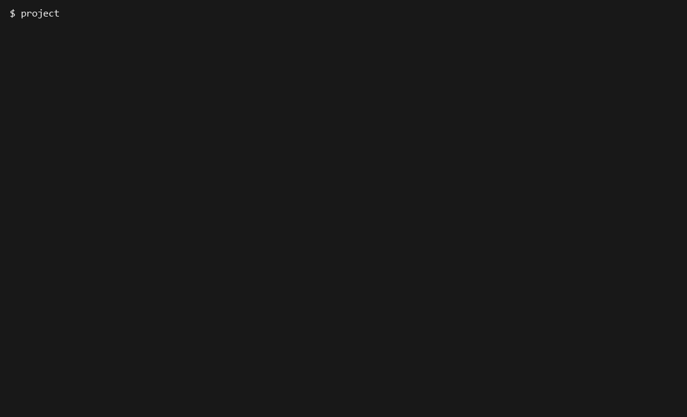

# Примитивная база данных

Матвеенко Михаил Юрьевич, группа M26-555.

Консольное приложение для работы с таблицами и записями. Схемы и данные
сохраняются в JSON и остаются доступными после перезапуска программы.

## Установка и запуск

Нужны Python 3.12 и uv. Если Python этой версии не установлен, uv скачает его.
Выполнить из папки проекта:

```console
uv sync
uv run project
```

Также работают `uv run database` и `uv run python -m primitive_db.main`.
Команда `help` показывает справку, `exit` завершает работу.
Для выхода также можно использовать Ctrl+C или конец ввода.

При установленном GNU Make доступны `make install`, `make run` и `make lint`.

## Управление таблицами

```text
create_table users name:str age:int is_active:bool
list_tables
info users
drop_table users
```

При создании таблицы автоматически добавляется первый столбец `ID:int`.
Поддерживаются типы `int`, `str` и `bool`. Имена таблиц и столбцов должны
быть идентификаторами: например, `users` или `is_active`.
Таблицы с именами, различающимися только регистром, создать нельзя.

## CRUD-операции

```text
insert into users values ("Sergei Ivanov", 28, true)
insert into users values ("Anna", 25, false)
select from users
select from users where age = 28
update users set age = 29, is_active = false where ID = 1
delete from users where ID = 1
```

Строки заключаются в одинарные или двойные кавычки. Пробелы, запятые и знак
`=` внутри кавычек считаются частью строки. Экранирование кавычек не реализовано:
если в тексте есть апостроф, используйте двойные кавычки, и наоборот.
Логические значения задаются как `true` и `false`, числа — без кавычек.
Например, `28` — число, а `"28"` — строка.

Все поля обязательны. ID не передаётся при вставке и не изменяется через `update`.
Новый ID равен максимальному ID среди оставшихся записей плюс один.
Условие `where` содержит одно равенство. Для `update` и `delete` оно обязательно.
В `set` можно перечислить несколько полей через запятую.

## Ошибки, подтверждение и кэш

Ошибки типов, неизвестные таблицы и столбцы, неправильные команды и ошибки
чтения JSON выводятся в консоль. После этого можно ввести следующую команду.

Перед `delete` и `drop_table` программа запрашивает подтверждение.
Ответ `y` разрешает удаление, любой другой ответ или Enter отменяет его.
Для `insert` и `select` выводится время выполнения.

Одинаковые выборки кэшируются в замыкании. После изменения данных кэш
очищается. В ключе учитываются сами записи и условие, поэтому изменения
файла другим сеансом тоже не приводят к выдаче старого результата.

## Хранение и структура

В текущей рабочей папке создаются `db_meta.json` со схемами таблиц и каталог
`data/` с отдельными файлами записей. Эти файлы добавлены в `.gitignore`.
Запускайте программу из одной папки, чтобы работать с одной базой.

```text
src/primitive_db/
    __init__.py     — пустой файл пакета
    main.py         — точка входа
    engine.py       — консольный цикл и вывод
    core.py         — операции с таблицами и записями
    utils.py        — чтение и запись файлов
    parser.py       — разбор команд и значений
    decorators.py   — ошибки, подтверждение, время и кэш
    constants.py    — пути, типы и справка
```

## Проверка и сборка

```console
uv run ruff check .
uv run ruff format --check .
uv build
uvx twine check dist/*
```

Twine проверяет метаданные локально, пакет при этом не публикуется.
Для установки собранного приложения можно выполнить
`uv tool install dist/primitive_db-0.1.0-py3-none-any.whl` и затем запустить `project`.

## Демонстрация

Запись показывает создание таблицы, вставку, выборку, обновление и удаление
записей, отмену и подтверждение удаления, просмотр информации и удаление таблицы.

[](docs/demo.cast)

[Запись asciinema](docs/demo.cast) · [Текст сеанса](docs/demo.txt)

Запись сохранена локально в формате asciicast v2. Её можно воспроизвести командой
`asciinema play docs/demo.cast`. Для будущей публикации на сервисе используется
`asciinema upload docs/demo.cast`; полученную ссылку можно добавить сюда.
